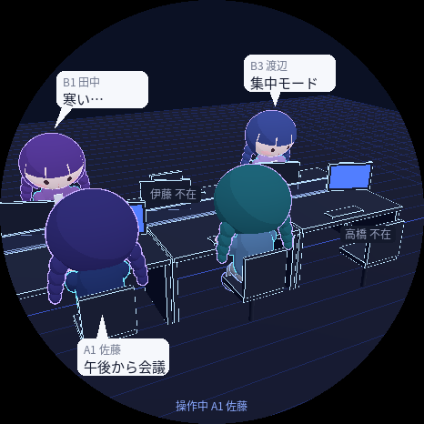

# 電脳オフィス

オフィスの「島」をミニキャラで見せる、在席・ひとりごと共有ボードです。
在席している人のキャラだけが席に座り、頭の上に「寒い…」「集中モード」などのひとりごとが出ます。

- **ブラウザ版**: Three.js の 3D オフィス（`/`）と、自分の在席・ひとりごと・キャラを切り替えるマイページ（`/me`）
- **StopWatch 版（おまけ）**: M5Stack StopWatch の丸い画面に同じ島を表示し、タップで在席を切り替える



キャラを自分で作って追加したり、メンバーや席を書き換えたりして、自分のオフィスにアレンジして遊べます。

## まず動かす（ブラウザだけ・実機なし）

Node.js 18 以上があれば動きます（`npm install` は不要です）。

```bash
node server/server.js
```

起動すると `http://localhost:8080/` が表示されます。同じ Wi-Fi の人には `http://<この PC の IP>:8080/` を共有してください。

- `/` オフィス: 在席の人だけキャラが座り、ひとりごとはリアルタイムで変わります。キャラを選んでいない人は、席ごとに決まったキャラで仮表示されます。
- `/me` マイページ: 自分を選ぶと `/me/<id>` に移ります（ブックマーク推奨）。在席の切り替え、ひとりごと（定型文か 20 文字まで。30 分・2 時間・今日中で消える）、キャラ選びができます。
- 「マイクでガヤガヤ」: その PC のマイクで周りの話し声を拾い、大きいほど島に漫画のギザギザが出てキャラがざわつきます。音は保存も送信もしません。ブラウザの制限で `localhost` か https で開いたときだけ使えます（「お試し」ならマイクなしで見た目を確認できます）。
- 毎晩 22:00 に全員を不在に戻します（`RESET_AT=21:30 node server/server.js` で変更）。

> **注意**: 認証はありません。URL を知っていれば誰の状態でも変えられるので、社内 LAN など信頼できるネットワークの中だけで使ってください。インターネットに公開しないでください。

## 自分のオフィスにする

### メンバーと席

`server/members.example.json` を `server/members.json` にコピーして書き換えます（`members.json` は git に入りません）。

```json
[
  { "id": "sato", "name": "佐藤", "seat": "A1" }
]
```

- `id`: URL に使う英数字（`/me/sato`）
- `seat`: `A1`〜`A3`（手前の列）、`B1`〜`B3`（奥の列）

状態（在席・ひとりごと・選んだキャラ）は `server/data/state.json` に保存されます。

### キャラを追加する

キャラは作成者ごとのフォルダ `characters/<作成者>/` に入っていて、マイページでは作成者ごとのタブになります。雛形 `characters/_template.html` をコピーして自分のフォルダで作り、一覧（`characters.json`）に足すと、オフィスとマイページに出てきます。作風は自由で、オフィスで動くための決まりだけ守れば大丈夫です。作り方・チェックのしかた・Pull Request の送り方は [CONTRIBUTING.md](CONTRIBUTING.md) を見てください。コードを書かずに Claude Code に話しかけて作る方法は [docs/claude-code.md](docs/claude-code.md) にあります。

公開しないで自分のオフィスだけで使うキャラは `characters/local/`（git に入りません）に置きます。

## フォルダ構成

| パス | 中身 |
|---|---|
| `server/` | サーバ（`server.js`）と画面（`public/`）。依存パッケージなし |
| `characters/` | 作成者ごとのフォルダにキャラ（`<id>.html` = 3D モデル、`<id>_front.png` = マイページ用の画像）と一覧 `characters.json`。雛形 `_template.html` |
| `firmware/` | StopWatch のファームウェア（`main.cpp`、焼き込んだ絵 `office_art.h`） |
| `tools/` | キャラのチェック（`check_chara.mjs`）、3D の絵を StopWatch 用に焼くスクリプト（Python + ヘッドレス Chromium） |
| `docs/` | 実装メモ |
| `.github/` | Pull Request のときのキャラのチェック（GitHub Actions）と PR のテンプレート |
| `platformio.ini` | StopWatch のビルド設定 |

## StopWatch 版（任意）

[M5Stack StopWatch](https://docs.m5stack.com/en/products/sku/C152) を持っている場合だけ必要です。

### 書き込み

- VS Code + PlatformIO でこのフォルダを開き、下のステータスバーの「→（Upload）」を押す
- またはターミナルで `pio run -t upload`（`pio` が見つからないときは `~/.platformio/penv/bin/pio run -t upload`）
- 書き込めないときは、リセットボタンを約 2 秒長押し（内部の緑 LED 点灯）してダウンロードモードにしてから再実行

### サーバにつなぐ（Wi-Fi）

1. `firmware/denno_config.example.h` を `firmware/denno_config.h` にコピーする（`denno_config.h` は git に入りません）
2. Wi-Fi の名前とパスワード（2.4GHz のみ）、サーバを動かす PC の名前（`SERVER_HOST`、例 `my-mac.local`）を書く
3. 書き込む

`denno_config.h` が無い、または `WIFI_SSID` が空のときは、端末だけで動きます。

- 3 秒ごとに `/api/device` を取りに行き、在席・名前・ひとりごとを反映します。端末のタップ（在席）と BtnB（ひとりごと、2 時間で消える）はサーバに送ります。
- 画面下「操作中」の左の点: 緑 = 同期中 / 橙 = Wi-Fi はつながったがサーバに届かない / 灰 = Wi-Fi 接続中。詳しくはシリアル（115200）の `[net]` の行を見てください。
- マイページで選んだキャラを実機に出すには、サーバの PC に `tools/` の環境（下）を用意しておきます。サーバが新しいキャラを StopWatch 用の絵（`server/sprites/`）に自動で焼きます。

### 操作

- 画面タップ: タップした席の在席 / 不在
- BtnA: 操作する席を次へ（画面下に表示）
- BtnB: 選択中の席のひとりごと（定型文）を順送り
- シリアル（115200）: `p 3` 席 3 の在席切替 / `c 3 寒い…` 席 3 にひとりごと / `c 3` 消去（席番号 0-2 = A1-A3、3-5 = B1-B3）

### tools の環境

```bash
cd tools
npm install
python3 -m venv .venv
.venv/bin/pip install -r requirements.txt
.venv/bin/playwright install chromium
```

島の見た目（机・カメラ・背景）を変えて焼き直す手順は [docs/IMPLEMENTATION.md](docs/IMPLEMENTATION.md) を見てください。

## API

| メソッド | パス | 内容 |
|---|---|---|
| GET | `/api/state` | 全員の状態 |
| GET | `/api/characters` | キャラ一覧 |
| PATCH | `/api/members/<id>` | `{ present?, comment?: { text, duration } \| null, character?: "maple/c01" \| null }` |
| GET | `/api/events` | 状態が変わるたびに `state` を送る（Server-Sent Events） |
| GET | `/api/device` | StopWatch 用（1 行 1 席のタブ区切り） |

## ライセンス

[MIT License](LICENSE)。コードもキャラ（`characters/`）も、改変・再配布・商用利用を含めて自由に使えます。再配布するときは LICENSE の著作権表示を残してください。
