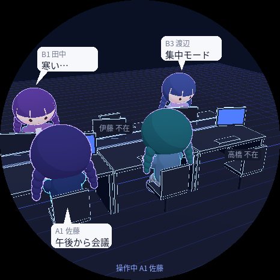
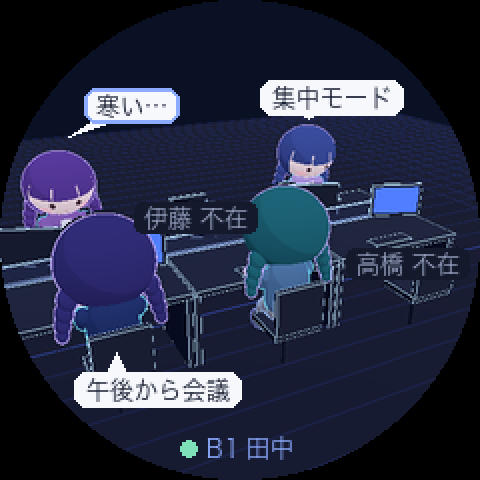

# 電脳オフィス

オフィスの「島」をミニキャラで見せる、在席・ひとりごと共有ボードです。
在席している人のキャラだけが席に座り、頭の上に「寒い…」「集中モード」などのひとりごとが出ます。
席の決め方は 2 つから選べます（[docs/seat-modes.md](docs/seat-modes.md)）。全体の仕組みは [docs/SYSTEM.md](docs/SYSTEM.md) に 1 枚でまとめています。

- **固定席**（既定）: 席は一人ずつ決まっています。IC カードを Dial にかざすと在席 / 不在が切り替わります
- **フリーアドレス**（`SEAT_MODE=free`）: その日に座る席を、机の Dial にカード・席の NFC タグにスマホ・マイページの席の図で決めます

- **ブラウザ版**: Three.js の 3D オフィス（`/`）、在席・ひとりごと・キャラを切り替えるマイページ（`/me`）、登録（`/join`）と管理（`/admin`）
- **StopWatch 版（おまけ）**: M5Stack StopWatch の丸い画面に同じ島を表示し、タップで在席を切り替える
- **Dial 版（おまけ）**: M5Dial の小さな丸い画面に同じ島を表示し、IC カードで在席を切り替える。つまみで自分のひとことを選ぶ



キャラを自分で作って追加したり、メンバーや席を書き換えたりして、自分のオフィスにアレンジして遊べます。

## まず動かす（ブラウザだけ・実機なし）

Node.js 18 以上があれば動きます（`npm install` は不要です）。

```bash
node server/server.js
```

フリーアドレスで動かすときは `SEAT_MODE=free node server/server.js` です。起動すると `http://localhost:8080/` が表示されます。同じ Wi-Fi の人には `http://<この PC の IP>:8080/` を共有してください。

- `/` オフィス: 在席の人だけキャラが座り、ひとりごとはリアルタイムで変わります。キャラを選んでいない人は、席ごとに決まったキャラで仮表示されます。
- `/me` マイページ: 自分を選ぶと `/me/<id>` に移ります（ブックマーク推奨）。在席の切り替え、フリーアドレスなら今日座る席（空いている席を押す。帰るときは「帰る」）、カードの登録、ひとりごと（定型文か 20 文字まで。30 分・2 時間・今日中で消える）、自分の定型文「オリジナル」の登録（10 個まで。Dial でも選べる）、キャラ選びができます。キャラ選びの「パーツで作成」タブでは、今いるキャラの髪型・服・ズボン・くつと色を組み合わせて自分の子を作れます（`characters/_parts.js`。作った子は `server/data/` に保存され、git には入りません）。
- `/join` はじめての登録: 名前 → 席（フリーアドレスは「いつもの席」、なくてもよい）→ カード（Dial にかざして出た 4 桁の番号）の順に入れると、マイページに移ってキャラを選べます。
- `/admin` 管理: つながった Dial の役割（固定席は全体用 / 個人用、フリーアドレスは置いた机）と、メンバーの名前・席・カードを直す・消す。
- `/tap` NFC タグ（フリーアドレス）: 席ごとのタグに書き込む URL の一覧。スマホでタグにタッチするとその席に座ります。
- 毎晩 22:00 に全員を不在に戻します（フリーアドレスは全員の席を空けます。`RESET_AT=21:30 node server/server.js` で変更）。

> **注意**: 認証はありません。URL を知っていれば誰の状態でも変えられるので、社内 LAN など信頼できるネットワークの中だけで使ってください。インターネットに公開しないでください。

## 自分のオフィスにする

### メンバーと席

メンバーは `/join` で一人ずつ登録します。名簿は `server/data/registry.json` に保存されます（git に入りません）。名前・席の直しと削除は `/admin` でできます。

- 席は `A1`〜`A3`（手前の列）、`B1`〜`B3`（奥の列）。固定席は 1 席に 1 人、フリーアドレスでは「いつもの席」（席を選ばずに在席にすると、空いていればそこに座る）で、なくてもよく重なってもかまいません。
- 最初に起動したときだけ、`server/members.json` があればそこから名簿を作ります（書き方は `members.example.json` と同じ。`id` は URL に使う英数字 `/me/sato`）。無ければ `members.example.json` の 6 人を「サンプル」として入れます。サンプルの人は、誰かが登録すると入れ替わります。

状態（在席・ひとりごと・選んだキャラ・フリーアドレスの今日の席）は `server/data/state.json` に保存されます。

### キャラを追加する

キャラは作成者ごとのフォルダ `characters/<作成者>/` に入っていて、マイページでは作成者ごとのタブになります。雛形 `characters/_template.html` をコピーして自分のフォルダで作り、一覧（`characters.json`）に足すと、オフィスとマイページに出てきます。作風は自由で、オフィスで動くための決まりだけ守れば大丈夫です。作り方・チェックのしかた・Pull Request の送り方は [CONTRIBUTING.md](CONTRIBUTING.md) を見てください。コードを書かずに Claude Code に話しかけて作る方法は [docs/claude-code.md](docs/claude-code.md) にあります。

公開しないで自分のオフィスだけで使うキャラは `characters/local/`（git に入りません）に置きます。

## フォルダ構成

| パス | 中身 |
|---|---|
| `server/` | サーバ（`server.js`、名簿・カード・Dial の `registry.js`）と画面（`public/`）。依存パッケージなし |
| `characters/` | 作成者ごとのフォルダにキャラ（`<id>.html` = 3D モデル、`<id>_front.png` = マイページ用の画像）と一覧 `characters.json`。雛形 `_template.html` |
| `firmware/` | StopWatch のファームウェア（`main.cpp`、焼き込んだ絵 `office_art.h`）。Dial 用は `firmware/dial/`（別のプログラム）。`firmware/tests/dial_card/` は Dial でカードが読めるかを確かめるだけのプログラム |
| `tools/` | キャラのチェック（`check_chara.mjs`）、3D の絵を StopWatch / Dial 用に焼くスクリプト（Python + ヘッドレス Chromium） |
| `docs/` | 実装メモ |
| `.github/` | Pull Request のときのキャラのチェック（GitHub Actions）と PR のテンプレート |
| `platformio.ini` | StopWatch と Dial のビルド設定 |

## StopWatch 版（任意）

[M5Stack StopWatch](https://docs.m5stack.com/en/products/sku/C152) を持っている場合だけ必要です。

### 書き込み

- VS Code + PlatformIO でこのフォルダを開き、下のステータスバーの「→（Upload）」を押す
- またはターミナルで `pio run -t upload`（`pio` が見つからないときは `~/.platformio/penv/bin/pio run -t upload`）
- 書き込めないときは、リセットボタンを約 2 秒長押し（内部の緑 LED 点灯）してダウンロードモードにしてから再実行

### サーバにつなぐ（Wi-Fi）

1. `firmware/denno_config.example.h` を `firmware/denno_config.h` にコピーする（`denno_config.h` は git に入りません）
2. Wi-Fi の名前とパスワード（2.4GHz のみ）、サーバを動かす PC の名前（`SERVER_HOST`、例 `my-mac.local`）を書く
3. 書き込む

`denno_config.h` が無い、または `WIFI_SSID` が空のときは、端末だけで動きます。

- 3 秒ごとに `/api/device` を取りに行き、在席・名前・ひとりごとを反映します。端末のタップ（在席）と BtnB（ひとりごと、2 時間で消える）はサーバに送ります。
- 画面下「操作中」の左の点: 緑 = 同期中 / 橙 = Wi-Fi はつながったがサーバに届かない / 灰 = Wi-Fi 接続中。詳しくはシリアル（115200）の `[net]` の行を見てください。
- マイページで選んだキャラを実機に出すには、サーバの PC に `tools/` の環境（下）を用意しておきます。サーバが新しいキャラを StopWatch 用の絵（`server/sprites/`）に自動で焼きます。

### 操作

- 画面タップ: タップした席の在席 / 不在
- BtnA: 操作する席を次へ（画面下に表示）
- BtnB: 選択中の席のひとりごと（定型文）を順送り
- シリアル（115200）: `p 3` 席 3 の在席切替 / `c 3 寒い…` 席 3 にひとりごと / `c 3` 消去（席番号 0-2 = A1-A3、3-5 = B1-B3）

### tools の環境

```bash
cd tools
npm install
python3 -m venv .venv
.venv/bin/pip install -r requirements.txt
.venv/bin/playwright install chromium
```

島の見た目（机・カメラ・背景）を変えて焼き直す手順は [docs/IMPLEMENTATION.md](docs/IMPLEMENTATION.md) を見てください。

## Dial 版（任意）

[M5Dial](https://docs.m5stack.com/en/core/M5Dial) を持っている場合だけ必要です。StopWatch 版とは別のプログラム（`firmware/dial/`）で、240×240 の画面と、追加メモリ（PSRAM）が無いことに合わせてあります。



### 書き込み

- ターミナルで `pio run -e m5stack-dial -t upload`（`pio` が見つからないときは `~/.platformio/penv/bin/pio run -e m5stack-dial -t upload`）
- VS Code の PlatformIO では、下のステータスバーで環境を `env:m5stack-dial` に切り替えてから「→（Upload）」を押す（何も選ばないと StopWatch 用が書き込まれます）
- Wi-Fi の設定は StopWatch と同じ `firmware/denno_config.h` を使います
- 言葉：どの Dial にも日本語が入っています。英語か中国語も使うときは、書き込むときに選びます（入れた言葉の文とフォントだけが入るので、中国語の約 1MB のフォントは中国語のときだけ）
  - 日本語だけ: `pio run -e m5stack-dial -t upload`
  - 日本語 + 英語: `pio run -e m5stack-dial-en -t upload`
  - 日本語 + 中国語: `pio run -e m5stack-dial-zh -t upload`
  - どちらで出すかは、マイページの「Dial の言葉」で人ごとに選びます。個人用の Dial は持ち主、机の Dial は座っている人の言葉が、その Dial に入っていればその言葉で、無ければ日本語で出ます（全体用は日本語）。Dial に言葉を選ぶ操作はありません

### Dial の役割

Wi-Fi につながった Dial は `/admin` に出てきます（画面下の「Dial 1A2B」の 4 桁で見分ける）。役割は席の決め方で変わります。くわしくは [docs/seat-modes.md](docs/seat-modes.md)。

| 席の決め方 | 役割 | カードをかざすと |
|---|---|---|
| 固定席 | 全体用（入口・島の端など） | 登録したカードなら誰でも、その人の在席 / 不在 |
| 固定席 | 個人用（自分の机） | 持ち主のカードだけ。持ち主が不在のあいだ、背景がゆっくり光る |
| 固定席 | 未設定 | 全体用と同じ。かざした直後につまみを長押しすると、その人の個人用になる |
| フリーアドレス | 机（A1〜B3） | この机に座る / 離席から戻る / もう一度で帰る（席が空く） |
| フリーアドレス | 未設定 | 「机が未設定」と出る |

どの Dial でも、未登録のカードをかざすと 4 桁の番号が出ます。`/join` かマイページの「カード」に入れると、そのカードがその人のものになります。

### 操作

- カードをかざす: 上の表
- つまみを回す・画面をタップ: 席を選んで名札を見る（固定席の全体用・未設定）
- つまみを押す・画面をタップ: この Dial の席の人の「ひとこと選び」を開く（個人用・机）
- つまみを長押し: この Dial の席の人の在席 / 不在（フリーアドレスは離席。席は取ったまま）
- 画面を左右にスワイプ: タイマー画面。時間のひとこと（集中・休憩・会議・外出）の残り時間や、不在のときの戻りまでの時間を大きく出す（個人用・机はこの Dial の席の人、全体用は選んでいる席の人）。0 になっても音は鳴らさず、在席 / 不在も変えない（外出・戻りから帰ったらカードをかざす）。つまみ・画面のどれかをさわると島に戻る
- Wi-Fi なし（`WIFI_SSID` が空）のお試し: つまみで席を選び、押す = ひとこと選び、長押し = 在席 / 不在、画面タップ = その席の在席 / 不在、画面の長押し = その席のひとこと選び
- シリアル: StopWatch 版のコマンドに加えて `k 04A1B2C3`（その番号のカードをかざしたことにする）。画面下の点の色は StopWatch 版と同じです

### ひとこと選び

出荷時のデモと同じ見た目の 3 つの画面で選びます。

- ジャンル: ふちに 10 個のアイコン（集中・休憩・会議・外出・戻り・気温・予定・声かけ・オリジナル・消す）。回して選ぶ
- 時間（集中・休憩・会議・外出・戻り）: 回して時間を選ぶ（画面の − / ＋ をタップしてもよい）
  - 集中・休憩・会議 →「集中 〜15:30」。その時刻に消える
  - 外出 →「15:05 外出」（何分後に出るか）
  - 戻り → 不在（フリーアドレスは離席）になり、札が「田中 16:00戻り」になる（在席に戻るか夜のリセットで消える）
- 文（気温・予定・声かけ・オリジナル）: 回して選ぶ。オリジナルはマイページで登録した文
- 決める: つまみを押す / 画面の真ん中をタップ
- もどる: つまみを長押し / 画面のどこでも長押し / 下の「<」をタップ（20 秒さわらなければ島の画面に戻る）
- 時刻はサーバの時計を使います

マイページで選んだキャラは、サーバが StopWatch 用と一緒に Dial 用の小さい絵（`server/sprites/<キャラ>/dial/`）も焼きます。Dial は取り寄せた絵を本体のフラッシュに保存するので、電源を入れ直しても取り直しません。

## API

| メソッド | パス | 内容 |
|---|---|---|
| GET | `/api/state` | 全員の状態 |
| GET | `/api/characters` | キャラ一覧 |
| PATCH | `/api/members/<id>` | `{ seat?: "A2" \| null（フリーアドレスで座る / 帰る）, present?, comment?: { text, duration か until: "15:30" } \| null, back?: "16:00" \| null, originals?: ["文", …], character?: "maple/c01" \| null }` |
| GET | `/api/events` | 状態が変わるたびに `state` を送る（Server-Sent Events） |
| GET | `/api/device` | StopWatch 用（1 行 1 席のタブ区切り。7 列目は絵の版、8 列目は戻る時刻）。`?board=dial` で Dial 用（7 列目が Dial 用の絵の版）。だれもいない席は id と名前が空の行。席の行のあとに `#now`（サーバの時計）・`#mode`（`fixed` / `free`）・`#o`（オリジナルの文）の行が続く。`&mac=<MAC>` を付けると `#dial`（その Dial の役割）の行も付く |
| POST | `/api/members/<id>/tap` | `{ seat: "A2" }` NFC タグからのタッチ（フリーアドレス） |
| POST | `/api/register` ほか | 登録・カード・Dial（[docs/seat-modes.md](docs/seat-modes.md)） |

## ライセンス

[MIT License](LICENSE)。コードもキャラ（`characters/`）も、改変・再配布・商用利用を含めて自由に使えます。再配布するときは LICENSE の著作権表示を残してください。
