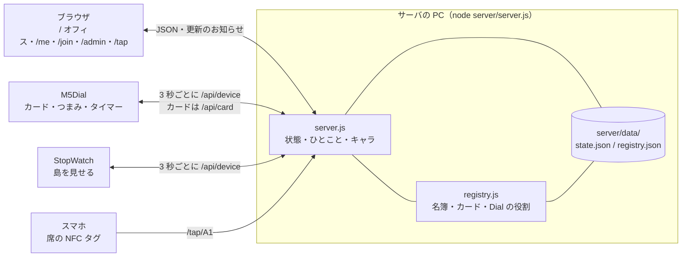

# 電脳オフィスの全体像

2026-11 時点で、どんな仕組みになっているかを 1 枚にまとめたものです。細かい使い方は各ページへのリンクを見てください。

- 使い方・はじめ方：[README](../README.md)
- 席の決め方（固定席 / フリーアドレス）・カード・Dial の役割・API：[seat-modes.md](seat-modes.md)
- 絵の焼き方・端末の中身：[IMPLEMENTATION.md](IMPLEMENTATION.md)
- キャラの作り方：[claude-code.md](claude-code.md)・[CONTRIBUTING.md](../CONTRIBUTING.md)

## ひとことで

オフィスの 1 つの島（6 席）を、ミニキャラで見せる在席ボードです。在席の人のキャラだけが席に座り、頭の上に「ひとこと」（寒い・集中 〜15:30 など）が出ます。
サーバは PC で 1 つだけ動かし、ブラウザ・M5Dial・StopWatch が同じ状態を見ます。



## 席の決め方は起動のときに選ぶ

```bash
node server/server.js                  # 固定席（既定）
SEAT_MODE=free node server/server.js   # フリーアドレス
```

| | 固定席 | フリーアドレス |
|---|---|---|
| 席 | 一人ずつ決まっている | その日に座る席をその場で決める |
| 在席でないとき | 不在 | 席を取ったまま外す =「離席」／席を空ける = 帰った |
| 夜のリセット（22:00） | 全員不在 | 全員の席が空く |
| 座り方・切り替え方 | Dial にカード・マイページ | 机の Dial にカード・席の NFC タグにスマホ・マイページの席の図 |
| Dial の役割 | 全体用 / 個人用（持ち主）/ 未設定 | 机（A1〜B3）/ 未設定 |

名簿・カード・キャラ・ひとこと・言葉は、どちらのモードでも同じものを使います。モードを切り替えても消えません。

## 人・カード・Dial

- **登録**：`/join` で名前と席（フリーアドレスは「いつもの席」。無くてもよい）を入れる。最初は `members.example.json` の 6 人が「サンプル」として座っていて、登録すると入れ替わる。
- **カード**：Dial にまだ登録していないカードをかざすと 4 桁の番号が出る。`/join` かマイページに入れると、そのカードがその人のものになる（10 分で切れる）。サーバにはカードの番号そのものではなく、番号から作った指紋だけを残す。読めるのは ISO14443A（MIFARE など）。Suica などの FeliCa は読めない。
- **Dial の役割**：Wi-Fi につながった Dial は `/admin` に自動で出てくる。そこで役割を決める。固定席では、未設定の Dial にカードをかざしてすぐ長押しすると、その人の個人用にもなる。
- **管理（`/admin`）**：Dial の役割、メンバーの名前・席・カードを外す・名簿から消す。ログインは無いので、社内 LAN の中だけで使う。

## Dial でできること

| 操作 | 個人用（固定席）・机（フリーアドレス） | 全体用・未設定（固定席） |
|---|---|---|
| カードをかざす | 在席 / 不在。机なら 座る → もう一度で帰る | 登録したカードの人の在席 / 不在 |
| つまみを押す・画面をタップ | その席の人の「ひとこと選び」 | 席を選んで名札を見る |
| つまみを長押し | その席の人の在席 ⇔ 不在（離席） | — |
| 画面を左右にスワイプ | **タイマー画面**（その席の人） | タイマー画面（選んでいる席の人） |

- **ひとこと選び**：ジャンル（集中・休憩・会議・外出・戻り・気温・予定・声かけ・オリジナル・消す）→ 時間か文。オリジナルはマイページで登録した自分の文。
- **タイマー画面**：集中・休憩・会議・外出のひとことを出しているとき、残り時間を大きく出す（例：休憩 のこり 8:42）。不在で戻り時刻を入れているときは「戻りまで」。外の輪が減っていき、0 になると 3 回鳴る。どこかをさわると島に戻る。
- **個人用の Dial の背景**：持ち主が不在のあいだ、ゆっくり明るくなったり戻ったりする（いるのに不在のまま、に気づけるように）。
- **言葉**：マイページの「Dial の言葉」で、日本語・English・中文（简体）から人ごとに選ぶ。Dial に言葉を選ぶ操作は無い。
  - 個人用の Dial は持ち主の言葉、机の Dial はいま座っている人の言葉で出る。全体用・未設定・だれもいない机は日本語。
  - 訳してあるのは、本人が見るところ（ひとこと選び・タイマー・不在の札・自分の在席の知らせ）。カード登録や Dial の設定の案内は日本語のまま。
- **Wi-Fi なし**（`denno_config.h` の `WIFI_SSID` が空）：お試しとして、6 席を全部さわれる。

StopWatch はカードを読めないので、島を見せる端末です（タップで在席、だれもいない席は「空き」）。

## サーバと端末のやりとり

端末は 3 秒ごとに `GET /api/device?board=dial&mac=<MAC>` を取りに行きます。中身は 1 行 1 席のタブ区切りと、`#` で始まる行です（知らない行は古い端末が読み飛ばす）。

| 行 | 中身 |
|---|---|
| `A1 …` | 席・id・在席・名前・ひとこと・キャラ・絵の版・戻り時刻 |
| `#now` | サーバの時計（0 時からの秒） |
| `#mode` | `fixed` / `free` |
| `#o` | オリジナルの文（席ごと） |
| `#t` | 時間のひとこと：席・種類（focus / rest / meeting / out）・残り秒・全体の秒 |
| `#dial` | この Dial の役割・席・持ち主・言葉 |

カードを読んだら `POST /api/card`、返事はタブ区切りの 1 行（`sit 名前 A1` など）。表は [seat-modes.md](seat-modes.md) にあります。

## データの置き場

| 場所 | 中身 | git |
|---|---|---|
| `server/data/registry.json` | 名簿・カードの指紋・Dial の役割 | 入らない |
| `server/data/state.json` | 在席・ひとこと・戻り時刻・オリジナル・キャラ・言葉・フリーアドレスの今日の席 | 入らない |
| `server/sprites/` | キャラの絵（StopWatch 用・Dial 用。サーバが自動で焼く） | 入らない |
| `firmware/denno_config.h` | Wi-Fi とサーバのアドレス | 入らない |
| `characters/<作成者>/` | キャラ（公開） | 入る |

## M5Dial のフラッシュ（8MB）

| 場所 | 大きさ | 中身 |
|---|---|---|
| `nvs` | 20KB | 設定 |
| `factory` | 5.7MB | プログラム本体。今は約 2.9MB（背景と席の絵、日本語のフォント 4 サイズ約 750KB、中国語のフォント 3 サイズ約 1MB） |
| `sprites` | 2.25MB | サーバから取り寄せたキャラの絵（192KB × 12。8MB のいちばん後ろ） |

中国語・英語を入れたときにプログラムが前の置き場（3MB）に入らなくなったので、絵の置き場を後ろに寄せて広げました。今は半分ほど空いています。絵の置き場の場所を動かしたので、新しいプログラムを書き込んだ最初の起動では、キャラの絵を取り寄せ直します（数十秒）。

## ファイルの地図

| ファイル | 役目 |
|---|---|
| `server/server.js` | サーバ本体（状態・ひとこと・キャラ・端末向けの形式・ページ） |
| `server/registry.js` | 名簿・カード・Dial の役割（固定席とフリーアドレスの違いもここ） |
| `server/public/office.html` | オフィス（3D） |
| `server/public/me.html` | マイページ（在席・席の図・カード・Dial の言葉・ひとこと・キャラ） |
| `server/public/join.html` / `admin.html` / `tap.html` | 登録 / 管理 / NFC タグ |
| `firmware/dial/main.cpp` | M5Dial のプログラム（`partitions_dial.csv` がフラッシュの分け方） |
| `firmware/main.cpp` | StopWatch のプログラム |
| `firmware/tests/dial_card/` | カードが読めるかを確かめるだけのプログラム |
| `platformio.ini` | 書き込みの設定（`m5stack-stopwatch` / `m5stack-dial` / `dial-card-test`） |

## まだ決めていない・確かめていないこと

- ログインが無い（URL を知っていれば誰でも変えられる）。社内 LAN の中だけで使う前提。
- 島は 1 つ・6 席のまま。
- Dial の新しい画面（タイマー・中国語と英語の表示）は、書き込み用のデータが作れるところまで確かめた。実機の見た目はまだ。
- 机の Dial に人が座った直後の知らせ（「おはよう」など）は、まだ前の言葉で出ることがある（3 秒以内に切り替わる）。
- 26金大祭のブランチは、まだ取り込んでいない（決めたとおり）。
